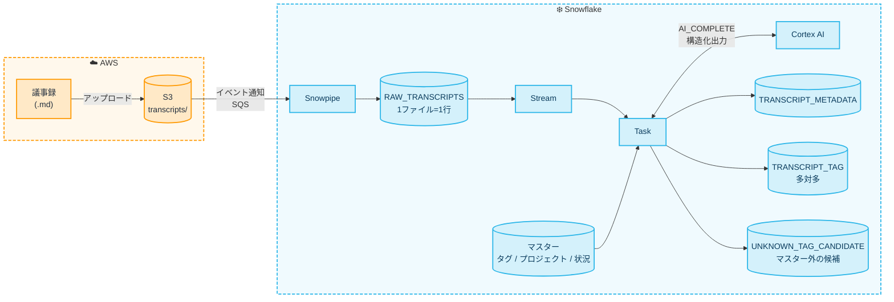

## はじめに

会議の議事録は、書いて共有フォルダに置いたらそれっきり、になりがちです。
後から「Snowflakeの話をしていた会議で、止まっている案件はどれだっけ?」と探そうとしても、ファイル名と全文検索くらいしか手がかりがありません。

そこで本記事では、Markdownで書いた議事録をS3に置くだけで、Snowflake上で次のメタデータが自動で付く仕組みを作ります。

- 関連する技術タグ(タグマスターにあるものだけ。複数)
- 関連するプロジェクト(プロジェクトマスターから1つ。該当なしもあり)
- 状況(進行中 / ブロック中 / 完了 など)
- 要約と、判断の根拠になった文

例えば、次のような議事録をアップロードすると、


1分ほどで、こんな行がテーブルに入ります。

| FILE_PATH | PROJECT_CODE | STATUS_CODE | マスター外の技術 |
| --- | --- | --- | --- |
| transcripts/meeting_2026-10-01_dev_weekly.md | PRJ-001 | IN_PROGRESS | 冪等キー(idempotency key)、決済API(外部決済代行連携) |

ポイントは、**タグやプロジェクトの候補をマスターテーブルで管理し、それをプロンプトに動的に埋め込む**ところです。
マスターに行を足すだけで、プロンプトを書き換えずに分類の基準を変えられます。

LLMの呼び出しには、SnowflakeのSQLから直接LLMを呼べる `AI_COMPLETE` 関数を使います。
構造化出力(JSON Schemaで出力の形を指定する機能)を使うので、結果をそのままテーブルに展開できます。

本記事で使ったTerraform・SQL・サンプルの議事録は、全て次のリポジトリで公開しています。
記事では要点となる部分だけを抜粋して掲載します。

https://github.com/yuuu/snowflake-meeting-minutes-metadata

## 全体像

構成は次の通りです。



取り込みと加工の骨組みは、以前の記事で紹介した「Snowpipe + Stream + Task」そのままです。
各要素の役割はこちらの記事で解説しているので、本記事では説明を省きます。

https://zenn.dev/fusic/articles/snowflake-snowpipe-task-intro

今回は、この「加工」の部分にLLMを入れます。
LLMの呼び出しはそれなりにコストがかかるので、取り込み(Snowpipe)と解析(Task)を分けておき、新しい議事録が来たときだけ解析が走るようにしています。

## 前提

- Snowflakeアカウントが AWS 上のリージョンにあること(本記事では `AWS_AP_NORTHEAST_1` で検証しました)
- `AI_COMPLETE` で使うモデルがリージョンで使えること。本記事の `claude-sonnet-4-6` は、東京リージョンではクロスリージョン推論(`CORTEX_ENABLED_CROSS_REGION`)を有効にして使っています
- Snowflake側は簡単のため `ACCOUNTADMIN` ロールで操作します(検証用です)
- ローカルに [Snowflake CLI](https://docs.snowflake.com/ja/developer-guide/snowflake-cli/index)、Terraform、AWS CLI が入っていること

モデルが使えるかは、次のSQLで手早く確認できます。

```sql
SELECT AI_COMPLETE('claude-sonnet-4-6', 'こんにちは、と一言で返して');
```

```text
+----------------+
| R              |
|----------------|
| "こんにちは！" |
+----------------+
```

クロスリージョン推論の設定は、次のように確認・変更できます。
有効にすると、データが他のリージョンで処理される場合がある点に注意してください。

```sql
SHOW PARAMETERS LIKE 'CORTEX_ENABLED_CROSS_REGION' IN ACCOUNT;
-- 有効化する場合
ALTER ACCOUNT SET CORTEX_ENABLED_CROSS_REGION = 'ANY_REGION';
```

## マスターと結果テーブルを作る

まずはSnowflake側に、分類の基準になる3つのマスターと、結果を入れるテーブルを作ります。

| テーブル | 内容 |
| --- | --- |
| TAG_MASTER | 技術タグ(コード、表示名、説明、別名) |
| PROJECT_MASTER | プロジェクト(コード、名称、説明、判定のヒントになるキーワード) |
| STATUS_MASTER | 状況(コード、名称、判定の目安) |
| RAW_TRANSCRIPTS | 議事録の本文(1ファイル=1行) |
| TRANSCRIPT_METADATA | 議事録ごとのプロジェクト・状況・要約・根拠 |
| TRANSCRIPT_TAG | 議事録とタグの多対多 |
| UNKNOWN_TAG_CANDIDATE | マスターに無かったタグの候補 |

マスターの「説明」や「別名」は、LLMが判断するためのヒントとしてプロンプトに入れます。
例えば `kubernetes` に別名 `EKS` を入れておくと、議事録に「EKS」としか書かれていなくても `kubernetes` タグが付きやすくなります。

主なテーブルの定義を抜粋します(全体は [sql/01_base.sql](https://github.com/yuuu/snowflake-meeting-minutes-metadata/blob/main/sql/01_base.sql) を参照してください)。

```sql
CREATE OR REPLACE TABLE TAG_MASTER (
  TAG_CODE    VARCHAR      NOT NULL PRIMARY KEY,  -- 例: aws-lambda
  TAG_NAME    VARCHAR      NOT NULL,              -- 表示名
  CATEGORY    VARCHAR,                            -- 例: Cloud / Frontend / Backend / DB / Security
  DESCRIPTION VARCHAR,                            -- LLMへ渡す説明
  ALIASES     ARRAY,                              -- 表記ゆれ・略称
  IS_ACTIVE   BOOLEAN      DEFAULT TRUE
);

INSERT INTO TAG_MASTER (TAG_CODE, TAG_NAME, CATEGORY, DESCRIPTION, ALIASES)
SELECT $1,$2,$3,$4,PARSE_JSON($5) FROM VALUES
 ('aws-s3','Amazon S3','Cloud','オブジェクトストレージ','["S3"]'),
 ('kubernetes','Kubernetes','Infra','コンテナオーケストレーション','["k8s","EKS"]'),
 ('nextjs','Next.js','Frontend','Reactベースのフレームワーク','["Next"]'),
 -- ...(全14件)
 ('observability','オブザーバビリティ','Ops','監視・ログ・トレース','["Datadog","CloudWatch","監視"]');

INSERT INTO STATUS_MASTER VALUES
 ('NOT_STARTED','未着手','着手前・計画段階・キックオフ'),
 ('IN_PROGRESS','進行中','作業が計画通り、または多少の課題はあるが進んでいる'),
 ('BLOCKED','ブロック中','外部要因や未解決の課題で作業が止まっている'),
 ('ON_HOLD','保留','意図的に中断・優先度下げ'),
 ('COMPLETED','完了','リリース済み・作業完了を宣言した'),
 ('UNKNOWN','不明','議事録から判断できない');

CREATE OR REPLACE TABLE TRANSCRIPT_METADATA (
  FILE_PATH       VARCHAR NOT NULL,
  PROJECT_CODE    VARCHAR,           -- マスターに存在する場合のみ。無ければNULL
  PROJECT_RAW     VARCHAR,           -- LLMが返した生の値(マスター外の検知用)
  STATUS_CODE     VARCHAR,
  SUMMARY         VARCHAR,
  EVIDENCE        ARRAY,             -- 判断の根拠となった文(原文の1文ずつ)
  RAW_RESPONSE    VARIANT,           -- LLMの生JSON(デバッグ・再正規化用)
  MODEL_NAME      VARCHAR,
  ANALYZED_AT     TIMESTAMP_LTZ DEFAULT CURRENT_TIMESTAMP(),
  PRIMARY KEY (FILE_PATH)
);
```

なお、Snowflakeの `PRIMARY KEY` は制約として強制されません(情報としてのみ保持されます)。
重複を防ぐ処理は、後述するTaskの中で行います。

## マスターを埋め込んだプロンプトを試す

自動化の前に、LLMにどう聞くかを決めておきます。

マスターは `LISTAGG` で箇条書きの文字列にして、`CONCAT` でプロンプトに埋め込みます。
`response_format` にJSON Schemaを渡すと、その形のJSONで結果が返ってきます。

```sql
WITH ctx AS (
  SELECT
    (SELECT LISTAGG('- ' || TAG_CODE || ': ' || TAG_NAME || '(' || COALESCE(DESCRIPTION,'') || ' / 別名: ' || COALESCE(ARRAY_TO_STRING(ALIASES, ','),'') || ')', '\n')
       WITHIN GROUP (ORDER BY TAG_CODE) FROM TAG_MASTER WHERE IS_ACTIVE) AS TAGS_TXT,
    (SELECT LISTAGG('- ' || PROJECT_CODE || ': ' || PROJECT_NAME || '(' || COALESCE(DESCRIPTION,'') || ' / キーワード: ' || COALESCE(ARRAY_TO_STRING(KEYWORDS, ','),'') || ')', '\n')
       WITHIN GROUP (ORDER BY PROJECT_CODE) FROM PROJECT_MASTER WHERE IS_ACTIVE) AS PROJECTS_TXT,
    (SELECT LISTAGG('- ' || STATUS_CODE || ': ' || STATUS_NAME || '(' || COALESCE(DESCRIPTION,'') || ')', '\n')
       WITHIN GROUP (ORDER BY STATUS_CODE) FROM STATUS_MASTER) AS STATUS_TXT
)
SELECT
  r.FILE_PATH,
  AI_COMPLETE(
    model => 'claude-sonnet-4-6',
    prompt => CONCAT(
      'あなたは会議議事録を分類するアシスタントです。以下のマスターに基づいて議事録を分析してください。\n',
      '## ルール\n',
      '- tags は「タグマスター」の TAG_CODE のみを使う。議事録で実質的に議論された技術のみ(言及だけは除く)。最大5個。\n',
      '- マスターに無いが重要な技術が議論されている場合は unknown_tags に自由記述で入れる。\n',
      '- project_code は「プロジェクトマスター」の PROJECT_CODE から1つ。判断できない場合は null。\n',
      '- status_code は「状況マスター」の STATUS_CODE から1つ。判断できない場合は UNKNOWN。\n',
      '- evidence には判断の根拠となる議事録内の文を1〜3個、原文から一字一句そのままコピーして配列で入れる。括弧・話者名・記号を付け足したり、複数の文をつなげたりしない。\n',
      '- summary は日本語で2文以内。\n\n',
      '## タグマスター\n', ctx.TAGS_TXT, '\n\n',
      '## プロジェクトマスター\n', ctx.PROJECTS_TXT, '\n\n',
      '## 状況マスター\n', ctx.STATUS_TXT, '\n\n',
      '## 議事録\n', r.CONTENT
    ),
    response_format => {
      'type': 'json',
      'schema': {
        'type': 'object',
        'properties': {
          'summary':      {'type': 'string'},
          'project_code': {'type': ['string','null']},
          'status_code':  {'type': 'string'},
          'tags':         {'type': 'array', 'items': {'type': 'string'}},
          'unknown_tags': {'type': 'array', 'items': {'type': 'string'}},
          'evidence':     {'type': 'array', 'items': {'type': 'string'}}
        },
        'required': ['summary','project_code','status_code','tags','unknown_tags','evidence'],
        'additionalProperties': false
      }
    }
  ) AS RESULT
FROM RAW_TRANSCRIPTS r CROSS JOIN ctx;
```

実際に試して分かったポイントは次の通りです。

- `response_format` を指定した `AI_COMPLETE` は、文字列ではなく **VARIANT** を返します。`PARSE_JSON` しなくても、`RESULT:project_code` のようにそのまま参照できます
- `'type': ['string','null']` のようなnull許容の型が使えます。「該当するプロジェクトなし」を `null` で表現できるので、`"NONE"` のような特別な文字列を決めずに済みます
- マスターに無いものは `unknown_tags` という逃げ道を用意しておきます。逃げ道がないと、LLMが無理やりマスターの中から近いものを選びがちです

返ってくるJSONは、例えば次のようになります。

```json
{
  "evidence": [
    "最近Rustでバックエンドを書く話が出ていて、WebAssemblyも含めて取り上げたい。",
    "既存のRailsサービスの一部を置き換えられるかの検討も面白そう。",
    "開催日はまだ決まっていない。まずは発表者を募集する。"
  ],
  "project_code": null,
  "status_code": "NOT_STARTED",
  "summary": "来月の社内勉強会のテーマとしてRustおよびWebAssemblyを取り上げる方向でブレストが行われた。開催日は未定で、発表者の募集と告知文の作成が次のアクションとして挙がっている。",
  "tags": [
    "ruby-on-rails"
  ],
  "unknown_tags": [
    "Rust",
    "WebAssembly"
  ]
}
```

:::message
`evidence` は、最初は「根拠となる発言を原文のまま1〜2文」という文字列1つで指定していました。
ところが、LLMは `「...」` で囲んだり、`小林:` のように話者名を付けたり、離れた2文をつなげたりします。そのため、原文に本当にある文かを `CONTAINS` でチェックすると、**5件中0件** しか一致しませんでした。

上のように「1文ずつ配列で、一字一句そのまま」と指示を変えたところ、**14件中14件** が原文と一致するようになりました。
根拠を後から機械的に検証したい場合は、配列で受け取るのがおすすめです。
:::

## AWS側を作る(Terraform)

S3バケットと、SnowflakeがS3を読むためのIAMロールをTerraformで作ります。
コード全体は [terraform/main.tf](https://github.com/yuuu/snowflake-meeting-minutes-metadata/blob/main/terraform/main.tf) を参照してください。

ポイントは、Snowflake側の情報が揃うまで、IAMロールの信頼先とS3イベント通知を「仮の状態」にしておく部分です。

```hcl:main.tf(抜粋)
locals {
  prefix          = "transcripts/"
  second_phase    = var.snowflake_iam_user_arn != "" && var.snowflake_external_id != ""
  # Snowflake側の値が渡されるまでは、信頼先を仮に自アカウントにしておく
  trust_principal = local.second_phase ? var.snowflake_iam_user_arn : "arn:aws:iam::${data.aws_caller_identity.current.account_id}:root"
}

data "aws_iam_policy_document" "trust" {
  statement {
    actions = ["sts:AssumeRole"]
    principals {
      type        = "AWS"
      identifiers = [local.trust_principal]
    }
    # 外部IDの条件は、値が渡されてから付ける
    dynamic "condition" {
      for_each = local.second_phase ? [1] : []
      content {
        test     = "StringEquals"
        variable = "sts:ExternalId"
        values   = [var.snowflake_external_id]
      }
    }
  }
}

# Snowpipe auto-ingest 用のS3イベント通知。SQSのARNが渡されてから作る
resource "aws_s3_bucket_notification" "snowpipe" {
  count  = var.snowpipe_sqs_arn != "" ? 1 : 0
  bucket = aws_s3_bucket.transcripts.id

  queue {
    queue_arn     = var.snowpipe_sqs_arn
    events        = ["s3:ObjectCreated:*"]
    filter_prefix = local.prefix
    filter_suffix = ".md"
  }
}
```

SnowflakeとAWSは、お互いの情報が無いと設定を完成できません。
そのため、Snowflake側の作業を挟みながら `terraform apply` を **3回** に分けて実行します。

| 回 | AWS側で設定するもの | 必要なSnowflake側の情報 |
| --- | --- | --- |
| 1回目 | S3バケット、IAMロール(信頼先は仮に自アカウント) | なし |
| 2回目 | IAMロールの信頼ポリシー | Storage IntegrationのIAMユーザーARNと外部ID |
| 3回目 | S3イベント通知 | PipeのSQS ARN |

### 1回目: バケットとIAMロール

以降の `terraform` コマンドは、リポジトリの `terraform/` ディレクトリで実行します。

```sh
export BUCKET=meeting-transcripts-$(aws sts get-caller-identity --query Account --output text)-demo
terraform init
terraform apply -var "bucket_name=${BUCKET}"
terraform output
```

```text
bucket_name = "meeting-transcripts-<アカウントID>-demo"
role_arn = "arn:aws:iam::<アカウントID>:role/snowflake-meeting-transcripts-role"
```

### Storage Integrationを作る

出力された `role_arn` を使って、SnowflakeにStorage Integrationを作ります。

```sql
CREATE OR REPLACE STORAGE INTEGRATION MEETING_S3_INT
  TYPE = EXTERNAL_STAGE
  STORAGE_PROVIDER = 'S3'
  ENABLED = TRUE
  STORAGE_AWS_ROLE_ARN = 'arn:aws:iam::<アカウントID>:role/snowflake-meeting-transcripts-role'
  STORAGE_ALLOWED_LOCATIONS = ('s3://<バケット名>/transcripts/');

DESC INTEGRATION MEETING_S3_INT;
```

`DESC INTEGRATION` の結果から、`STORAGE_AWS_IAM_USER_ARN` と `STORAGE_AWS_EXTERNAL_ID` を控えます。

:::message alert
Storage Integrationを `CREATE OR REPLACE` で作り直すと、**外部IDが変わります**。
私は検証中にSQLファイルを再実行してしまい、IAMロールの信頼ポリシーと外部IDが食い違って、アクセスできなくなりました。

作り直す必要がある場合は、`STORAGE_AWS_EXTERNAL_ID = '<控えておいた外部ID>'` を指定すると、元の外部IDのまま作り直せます。
その場合も、Integrationを参照しているステージは作り直す必要がありました。
:::

### 2回目: 信頼ポリシーを差し替える

```sh
terraform apply -var "bucket_name=${BUCKET}" \
  -var "snowflake_iam_user_arn=<STORAGE_AWS_IAM_USER_ARN>" \
  -var 'snowflake_external_id=<STORAGE_AWS_EXTERNAL_ID>'
```

IAMロールの `assume_role_policy` だけが更新されます。

### ステージとSnowpipeを作る

議事録の `.md` ファイルを、**1ファイル=1行** としてテーブルに取り込みます。
CSV形式のファイルフォーマットで `FIELD_DELIMITER` と `RECORD_DELIMITER` を両方 `NONE` にすると、ファイル全体が1つの値として読み込まれます。
Markdownの改行や表の `|` もそのまま保たれます。

```sql
CREATE OR REPLACE FILE FORMAT MD_WHOLE_FILE
  TYPE = CSV
  FIELD_DELIMITER = NONE
  RECORD_DELIMITER = NONE
  FIELD_OPTIONALLY_ENCLOSED_BY = NONE
  ESCAPE_UNENCLOSED_FIELD = NONE
  ENCODING = 'UTF8';

CREATE OR REPLACE STAGE TRANSCRIPT_STAGE
  URL = 's3://<バケット名>/transcripts/'
  STORAGE_INTEGRATION = MEETING_S3_INT
  FILE_FORMAT = MD_WHOLE_FILE;

CREATE OR REPLACE PIPE TRANSCRIPT_PIPE
  AUTO_INGEST = TRUE
AS
COPY INTO RAW_TRANSCRIPTS (FILE_PATH, CONTENT)
FROM (
  SELECT METADATA$FILENAME, $1
  FROM @TRANSCRIPT_STAGE
)
PATTERN = '.*[.]md';

SHOW PIPES LIKE 'TRANSCRIPT_PIPE';
```

`SHOW PIPES` の `notification_channel` 列(SQSのARN)を控えます。

:::message
`CREATE PIPE` の時点で、SnowflakeがIAMロールを引き受けられるかがチェックされます。
信頼ポリシーを差し替える前(1回目の `apply` 直後)に実行すると、次のエラーになりました。

```text
003167 (42601): Error assuming AWS_ROLE: User: arn:aws:iam::<Snowflake側>:user/xxxx is not authorized to perform: sts:AssumeRole on resource: arn:aws:iam::<アカウントID>:role/snowflake-meeting-transcripts-role
```

そのため、「信頼ポリシーの差し替え」と「S3イベント通知の設定」は別々の `apply` に分ける必要があります。
:::

### 3回目: S3イベント通知を設定する

```sh
terraform apply -var "bucket_name=${BUCKET}" \
  -var "snowflake_iam_user_arn=<STORAGE_AWS_IAM_USER_ARN>" \
  -var 'snowflake_external_id=<STORAGE_AWS_EXTERNAL_ID>' \
  -var "snowpipe_sqs_arn=<notification_channel>"
```

`SYSTEM$PIPE_STATUS` で、Pipeが動いていることを確認しておきます。

```sql
SELECT SYSTEM$PIPE_STATUS('MEETING_DB.APP.TRANSCRIPT_PIPE');
```

```json
{"executionState":"RUNNING","pendingFileCount":0,"notificationChannelName":"arn:aws:sqs:ap-northeast-1:xxxx:sf-snowpipe-xxxx", ...}
```

## Stream + Task でLLM解析を自動化する

`RAW_TRANSCRIPTS` に新しい行が入ったら、先ほどのプロンプトで解析し、結果を3つのテーブルに書き込むTaskを作ります。
全体は [sql/04_pipeline.sql](https://github.com/yuuu/snowflake-meeting-minutes-metadata/blob/main/sql/04_pipeline.sql) にあります。ここでは、LLMの呼び出し(前章と同じ)以外の部分を抜粋します。

```sql
CREATE OR REPLACE STREAM RAW_TRANSCRIPTS_STREAM ON TABLE RAW_TRANSCRIPTS APPEND_ONLY = TRUE;

CREATE OR REPLACE TASK ANALYZE_TRANSCRIPTS_TASK
  WAREHOUSE = MEETING_WH
  SCHEDULE = '1 MINUTE'
  WHEN SYSTEM$STREAM_HAS_DATA('MEETING_DB.APP.RAW_TRANSCRIPTS_STREAM')
AS
EXECUTE IMMEDIATE $$
BEGIN
  -- 1. ストリームを読んで一時テーブルへ。同じファイルが複数回入っていたら最新の1行だけ使う
  CREATE OR REPLACE TEMPORARY TABLE TMP_NEW AS
    SELECT FILE_PATH, CONTENT FROM RAW_TRANSCRIPTS_STREAM
    QUALIFY ROW_NUMBER() OVER (PARTITION BY FILE_PATH ORDER BY LOADED_AT DESC) = 1;

  -- 2. LLM呼び出し(1ファイル1回)。中身は前章のSELECTと同じなので省略
  CREATE OR REPLACE TEMPORARY TABLE TMP_RESULT AS
    SELECT n.FILE_PATH, AI_COMPLETE(...) AS R FROM TMP_NEW n CROSS JOIN ctx c;

  -- 3. メタデータ(マスターに無い値はNULL化し、生の値は残す)
  MERGE INTO TRANSCRIPT_METADATA t
  USING (
    SELECT
      r.FILE_PATH,
      pm.PROJECT_CODE,
      r.R:project_code::STRING AS PROJECT_RAW,
      COALESCE(sm.STATUS_CODE, 'UNKNOWN') AS STATUS_CODE,
      r.R:summary::STRING AS SUMMARY,
      r.R:evidence::ARRAY AS EVIDENCE,
      r.R AS RAW_RESPONSE
    FROM TMP_RESULT r
    LEFT JOIN PROJECT_MASTER pm ON pm.PROJECT_CODE = r.R:project_code::STRING
    LEFT JOIN STATUS_MASTER sm ON sm.STATUS_CODE = r.R:status_code::STRING
    WHERE r.R IS NOT NULL
  ) s ON t.FILE_PATH = s.FILE_PATH
  WHEN MATCHED THEN UPDATE SET ...
  WHEN NOT MATCHED THEN INSERT ...;

  -- 4. タグ(多対多)。マスターに存在するものだけ展開。再解析に備えて一度削除
  DELETE FROM TRANSCRIPT_TAG WHERE FILE_PATH IN (SELECT FILE_PATH FROM TMP_RESULT WHERE R IS NOT NULL);
  INSERT INTO TRANSCRIPT_TAG (FILE_PATH, TAG_CODE)
    SELECT DISTINCT r.FILE_PATH, tm.TAG_CODE
    FROM TMP_RESULT r, LATERAL FLATTEN(input => r.R:tags) f
    JOIN TAG_MASTER tm ON tm.TAG_CODE = f.value::STRING AND tm.IS_ACTIVE;

  -- 5. マスター外のタグ候補(unknown_tags + tagsに入っていたがマスターに無いもの)
  DELETE FROM UNKNOWN_TAG_CANDIDATE WHERE FILE_PATH IN (SELECT FILE_PATH FROM TMP_RESULT WHERE R IS NOT NULL);
  INSERT INTO UNKNOWN_TAG_CANDIDATE (FILE_PATH, TAG_RAW)
    SELECT r.FILE_PATH, f.value::STRING
    FROM TMP_RESULT r, LATERAL FLATTEN(input => r.R:unknown_tags) f
    UNION
    SELECT r.FILE_PATH, f.value::STRING
    FROM TMP_RESULT r, LATERAL FLATTEN(input => r.R:tags) f
    WHERE f.value::STRING NOT IN (SELECT TAG_CODE FROM TAG_MASTER);
END;
$$;

ALTER TASK ANALYZE_TRANSCRIPTS_TASK RESUME;
```

設計上のポイントは次の通りです。

- **ストリームは最初に1回だけ読む**: Streamを `CREATE TABLE ... AS SELECT` で一時テーブルに移しています。この処理でStreamのオフセットが進み、Taskの実行後には `SYSTEM$STREAM_HAS_DATA` が `False` に戻ることを確認しました
- **マスターに無い値は捨てずに残す**: LLMがマスターに無いプロジェクトコードを返したら、`PROJECT_CODE` は `NULL` にし、生の値を `PROJECT_RAW` に残します。タグは `TAG_MASTER` と結合して、存在するものだけ `TRANSCRIPT_TAG` に入れ、それ以外は `UNKNOWN_TAG_CANDIDATE` に回します
- **LLMが失敗した行は書き込まない**: `AI_COMPLETE` はエラー時に `NULL` を返すので、`WHERE r.R IS NOT NULL` で除外しています。除外した行は次回以降にStreamに載らないので、本番運用では失敗したファイルを別テーブルに記録する処理を足すとよいです

## 動かしてみる

5本の議事録をS3にアップロードします。
技術・プロジェクト・状況がそれぞれ異なるように作ったサンプルで、中身は [samples/](https://github.com/yuuu/snowflake-meeting-minutes-metadata/tree/main/samples) にあります。

| ファイル | 内容 |
| --- | --- |
| [meeting_2026-09-30_ec_cart.md](https://github.com/yuuu/snowflake-meeting-minutes-metadata/blob/main/samples/meeting_2026-09-30_ec_cart.md) | ECリニューアルの週次定例。Next.jsへの移行が順調で、LCP改善のため画像をS3+CDNへ |
| [meeting_2026-10-01_data_platform.md](https://github.com/yuuu/snowflake-meeting-minutes-metadata/blob/main/samples/meeting_2026-10-01_data_platform.md) | データ分析基盤の進捗確認。PostgreSQLからの連携が、IP許可申請の未承認で止まっている |
| [meeting_2026-10-01_dev_weekly.md](https://github.com/yuuu/snowflake-meeting-minutes-metadata/blob/main/samples/meeting_2026-10-01_dev_weekly.md) | 冒頭の画像の議事録。決済タイムアウトの障害対応とリリース延期 |
| [meeting_2026-10-02_auth_sso.md](https://github.com/yuuu/snowflake-meeting-minutes-metadata/blob/main/samples/meeting_2026-10-02_auth_sso.md) | 認証基盤統合のリリース後レビュー。SSO移行が完了し、プロジェクトをクローズ |
| [meeting_2026-10-02_study_session.md](https://github.com/yuuu/snowflake-meeting-minutes-metadata/blob/main/samples/meeting_2026-10-02_study_session.md) | 社内勉強会の企画ブレスト。どのプロジェクトにも属さず、Rust・WebAssemblyはマスター外 |

例えば ec_cart は次のような内容です。

```markdown:meeting_2026-09-30_ec_cart.md
# ECリニューアル 週次定例

| 項目 | 内容 |
|---|---|
| 日付 | 2026-09-30 |
| 参加者 | 田中(PM)、佐藤(FE)、鈴木(BE) |

## 議事

- 田中: 先週に引き続きカート画面の実装状況を確認したい。
- 佐藤: Next.jsのApp Routerへの移行は8割終わった。カートの状態管理はTypeScriptの型定義を整理して、ほぼ完了。
- 佐藤: ただ、商品一覧ページのLCPが3.5秒あり、目標の2.5秒に届いていない。画像をS3に置いてCDN配信に切り替える方向で調整する。
- 鈴木: 画像のS3バケットは今週中に作る。決済APIの仕様は先方から回答済みなので問題ない。
- 田中: スケジュールは予定通り。来週は決済画面の実装に入る。

## 決定事項

1. 画像配信をS3+CDNへ変更する
2. 来週から決済画面に着手する
```

```sh
aws s3 cp ./samples/ "s3://${BUCKET}/transcripts/" --recursive --exclude "*" --include "*.md"
```

アップロードしてから約50秒で `RAW_TRANSCRIPTS` に取り込まれ、約80秒で解析まで完了しました。

```sql
SELECT FILE_PATH, LENGTH(CONTENT) LEN, LOADED_AT FROM RAW_TRANSCRIPTS ORDER BY FILE_PATH;
```

```text
+------------------------------------------------------------------------------------------+
| FILE_PATH                                       | LEN | LOADED_AT                        |
|-------------------------------------------------+-----+----------------------------------|
| transcripts/meeting_2026-09-30_ec_cart.md       | 401 | 2026-10-16 16:34:20.563000-07:00 |
| transcripts/meeting_2026-10-01_data_platform.md | 412 | 2026-10-16 16:34:20.563000-07:00 |
| transcripts/meeting_2026-10-01_dev_weekly.md    | 690 | 2026-10-16 16:34:20.563000-07:00 |
| transcripts/meeting_2026-10-02_auth_sso.md      | 352 | 2026-10-16 16:34:20.563000-07:00 |
| transcripts/meeting_2026-10-02_study_session.md | 271 | 2026-10-16 16:34:20.563000-07:00 |
+------------------------------------------------------------------------------------------+
```

1ファイルが1行で取り込まれ、`LEN` も元のファイルの文字数と一致しています。
なお、`METADATA$FILENAME` にはステージのURLより後ろのパスではなく、`transcripts/` から始まるパスが入っていました。

Taskの実行履歴は次の通りです。5件のLLM呼び出しを含めて、約11秒で終わっています。

```text
+------------------------------------------------------------------------------------------------------------+
| NAME                     | STATE     | SCHEDULED_TIME                   | COMPLETED_TIME                   |
|--------------------------+-----------+----------------------------------+----------------------------------|
| ANALYZE_TRANSCRIPTS_TASK | SUCCEEDED | 2026-10-16 16:34:58.693000-07:00 | 2026-10-16 16:35:09.262000-07:00 |
+------------------------------------------------------------------------------------------------------------+
```

解析結果を見てみます。

```sql
SELECT FILE_PATH, PROJECT_CODE, STATUS_CODE FROM TRANSCRIPT_METADATA ORDER BY FILE_PATH;
```

```text
+--------------------------------------------------------------------------------+
| FILE_PATH                                       | PROJECT_CODE | STATUS_CODE |
|-------------------------------------------------+--------------+-------------|
| transcripts/meeting_2026-09-30_ec_cart.md       | PRJ-001      | IN_PROGRESS |
| transcripts/meeting_2026-10-01_data_platform.md | PRJ-002      | BLOCKED     |
| transcripts/meeting_2026-10-01_dev_weekly.md    | PRJ-001      | IN_PROGRESS |
| transcripts/meeting_2026-10-02_auth_sso.md      | PRJ-004      | COMPLETED   |
| transcripts/meeting_2026-10-02_study_session.md | None         | NOT_STARTED |
+--------------------------------------------------------------------------------+
```

```sql
SELECT FILE_PATH, LISTAGG(TAG_CODE, ', ') WITHIN GROUP (ORDER BY TAG_CODE) TAGS
FROM TRANSCRIPT_TAG GROUP BY 1 ORDER BY 1;
```

```text
+----------------------------------------------------------------------------------------------------+
| FILE_PATH                                       | TAGS                                             |
|-------------------------------------------------+--------------------------------------------------|
| transcripts/meeting_2026-09-30_ec_cart.md       | aws-s3, nextjs, typescript, web-performance      |
| transcripts/meeting_2026-10-01_data_platform.md | github-actions, postgresql, snowflake, terraform |
| transcripts/meeting_2026-10-02_auth_sso.md      | kubernetes, oauth, observability                 |
| transcripts/meeting_2026-10-02_study_session.md | ruby-on-rails                                    |
+----------------------------------------------------------------------------------------------------+
```

```sql
SELECT FILE_PATH, TAG_RAW FROM UNKNOWN_TAG_CANDIDATE ORDER BY 1, 2;
```

```text
+-------------------------------------------------------------------------------+
| FILE_PATH                                       | TAG_RAW                     |
|-------------------------------------------------+-----------------------------|
| transcripts/meeting_2026-10-01_dev_weekly.md    | 冪等キー（idempotency key） |
| transcripts/meeting_2026-10-01_dev_weekly.md    | 決済API（外部決済代行連携） |
| transcripts/meeting_2026-10-02_study_session.md | Rust                        |
| transcripts/meeting_2026-10-02_study_session.md | WebAssembly                 |
+-------------------------------------------------------------------------------+
```

タグが正規化されたテーブルに入っているので、「Snowflakeが話題に出た会議のうち、止まっているもの」のような横断的な検索もSQLで書けます。

```sql
SELECT m.FILE_PATH, m.SUMMARY
FROM TRANSCRIPT_METADATA m
JOIN TRANSCRIPT_TAG t USING (FILE_PATH)
WHERE t.TAG_CODE = 'snowflake' AND m.STATUS_CODE = 'BLOCKED';
```

## 精度を確認する

あらかじめ用意しておいた想定の正解と比べると、次のようになりました。

| 議事録 | 想定 | 結果 |
| --- | --- | --- |
| ec_cart | PRJ-001 / IN_PROGRESS / nextjs, typescript, web-performance, aws-s3 | 完全一致 |
| data_platform | PRJ-002 / BLOCKED / snowflake, terraform, github-actions, postgresql | 完全一致 |
| auth_sso | PRJ-004 / COMPLETED / oauth, kubernetes, observability | 完全一致 |
| study_session | NULL / NOT_STARTED / タグなし、マスター外にRust・WebAssembly | `ruby-on-rails` が余分に付いた |
| dev_weekly | (正解を決めにくい議事録) | PRJ-001 / IN_PROGRESS。1回目の検証では BLOCKED |

内容がはっきりした議事録は、問題なく分類できています。
一方で、いくつか気になる点もありました。

### 「言及しただけ」の技術にもタグが付く

study_sessionでは「既存のRailsサービスの一部を置き換えられるかの検討も面白そう」という一言で、`ruby-on-rails` が付きました。
プロンプトで「言及だけは除く」と指示していますが、どこからが「議論」かは人間でも判断が分かれるところです。
厳しくしたい場合は、「その技術についての作業・決定・課題が議事録にある場合のみ」のように、判定の基準をより具体的に書く必要がありそうです。

### 判断が分かれる議事録では結果が揺れる

dev_weeklyは「決済のタイムアウト障害に対応しつつ、リリースを延期する」という内容です。
検証の途中で2回解析したところ、1回目は `BLOCKED`、2回目は `IN_PROGRESS` と判定されました(2回の間で変えたのは `evidence` の指示だけで、状況の判定に関わる部分は同じです)。

人間が見ても「遅れてはいるが止まってはいない」と「障害対応で止まっている」のどちらとも取れる内容です。
状況の定義(`STATUS_MASTER.DESCRIPTION`)を「遅延していても作業が続いていればIN_PROGRESS」のように具体的にすることで、揺れを減らせると思います。
また、`RAW_RESPONSE` と `EVIDENCE` を残しているので、なぜそう判定したかを後から人が確認できます。

### マスター外のタグは表記が揃わない

`unknown_tags` は自由記述なので、`冪等キー（idempotency key）` のように表記がばらつきます。
実際、1回目の検証では同じ議事録から `冪等キー` と返っていました。
あくまで「マスターに追加する候補を人が見るための材料」と割り切って使うのがよさそうです。

### 根拠の文は全て原文に存在した

前述の通り、`evidence` を「原文の1文ずつの配列」にしたことで、全ての根拠が原文と一致しました。
次のクエリで、LLMが根拠をでっち上げていないかを機械的にチェックできます。

```sql
SELECT m.FILE_PATH, e.value::STRING AS EVIDENCE, CONTAINS(r.CONTENT, e.value::STRING) AS FOUND
FROM TRANSCRIPT_METADATA m
JOIN (SELECT FILE_PATH, ANY_VALUE(CONTENT) CONTENT FROM RAW_TRANSCRIPTS GROUP BY 1) r USING (FILE_PATH),
LATERAL FLATTEN(input => m.EVIDENCE) e
ORDER BY 1;
```

```text
| FILE_PATH                                       | EVIDENCE                                                                         | FOUND |
|-------------------------------------------------+----------------------------------------------------------------------------------+-------|
| transcripts/meeting_2026-10-01_dev_weekly.md    | 9/29 夜間に決済APIのタイムアウトが**12件**発生。一部ユーザーで二重課金の疑いあり | True  |
| transcripts/meeting_2026-10-01_dev_weekly.md    | 回帰テスト遅延のため、リリースを 10/8 → **10/13** に延期する                     | True  |
| transcripts/meeting_2026-10-01_dev_weekly.md    | 決済タイムアウト対応を最優先とし、他タスクより先に着手する                       | True  |
...(全14件が True)
```

Markdownの `**` まで含めてそのまま返ってきているのが分かります。

## マスターを更新して再解析する

この仕組みの良いところは、マスターに行を足すだけで分類の基準を変えられる点です。
`UNKNOWN_TAG_CANDIDATE` に出てきた Rust をタグマスターに追加してみます。

```sql
INSERT INTO TAG_MASTER (TAG_CODE, TAG_NAME, CATEGORY, DESCRIPTION, ALIASES)
SELECT 'rust','Rust','Language','メモリ安全なシステムプログラミング言語',PARSE_JSON('["Rustlang"]');
```

既存の議事録を再解析するには、`RAW_TRANSCRIPTS` に同じ行をもう一度入れて、Streamに載せます。

```sql
INSERT INTO RAW_TRANSCRIPTS (FILE_PATH, CONTENT)
SELECT FILE_PATH, CONTENT FROM RAW_TRANSCRIPTS
WHERE FILE_PATH = 'transcripts/meeting_2026-10-02_study_session.md'
QUALIFY ROW_NUMBER() OVER (PARTITION BY FILE_PATH ORDER BY LOADED_AT DESC) = 1;
```

次のTask実行で、study_sessionに `rust` タグが付き、`UNKNOWN_TAG_CANDIDATE` からは Rust が消えました。

```text
-- TRANSCRIPT_TAG
| transcripts/meeting_2026-10-02_study_session.md | ruby-on-rails, rust |

-- UNKNOWN_TAG_CANDIDATE
| transcripts/meeting_2026-10-02_study_session.md | WebAssembly |
```

他の4件の `ANALYZED_AT` は変わっておらず、指定した1件だけが再解析されたことも確認できました。

```text
| transcripts/meeting_2026-09-30_ec_cart.md       | 2026-10-16 16:35:05.524000-07:00 |
| transcripts/meeting_2026-10-01_data_platform.md | 2026-10-16 16:35:05.524000-07:00 |
| transcripts/meeting_2026-10-01_dev_weekly.md    | 2026-10-16 16:35:05.524000-07:00 |
| transcripts/meeting_2026-10-02_auth_sso.md      | 2026-10-16 16:35:05.524000-07:00 |
| transcripts/meeting_2026-10-02_study_session.md | 2026-10-16 16:37:05.531000-07:00 |
```

この方法では `RAW_TRANSCRIPTS` に同じファイルの行が溜まっていきます。
そのため、Taskの最初で `QUALIFY ROW_NUMBER()` を使って、ファイルごとに最新の1行だけを解析対象にしています。

## コラム: AI_PARSE_DOCUMENTで読み込む方法との比較

Snowflakeには、ステージ上のファイルからテキストを抽出する `AI_PARSE_DOCUMENT` 関数もあります。
公式ドキュメントに載っている対応形式は PDF、DOCX、PPTX、画像、HTML、TXT で、`.md` は含まれていません。
ただ、試しに `.md` ファイルを渡してみると、エラーにならずにテキストが返ってきました。
(`PROBE_STAGE` は検証用に作った内部ステージです。`AI_PARSE_DOCUMENT` は内部・外部どちらのステージにも対応しています。)

```sql
SELECT AI_PARSE_DOCUMENT(
  TO_FILE('@PROBE_STAGE', 'meeting_2026-10-01_dev_weekly.md'),
  {'mode': 'LAYOUT'}, TRUE);
```

```json
{
  "error": null,
  "metadata": { "pageCount": 1 },
  "value": { "content": "# 開発定例 議事録\n\n| 項目 | 内容 |\n| --- | --- |\n..." }
}
```

ただし、中身をよく見ると原文と少し違っていました。

```text
原文 : **10/2(金)までに**タイムアウト値の見直しと…
結果 : **10/2(金)**までに**タイムアウト値の見直しと…
```

`AI_PARSE_DOCUMENT` は、ファイルを「文書」として解釈してから書き出し直すため、Markdownの記号の位置が変わることがあるようです。
また、TXTやHTMLは3,000文字ごとに1ページとして課金されます。

議事録がもともとテキスト(Markdown)であれば、本記事のようにSnowpipeでそのまま取り込む方が、原文に忠実で余計なコストもかかりません。
PDFやWordの議事録を扱う場合は、`AI_PARSE_DOCUMENT` で本文を取り出してから同じプロンプトにかける構成にするとよいと思います。

## コストの目安

`AI_COMPLETE` の使用量は、`SNOWFLAKE.ACCOUNT_USAGE.CORTEX_AI_FUNCTIONS_USAGE_HISTORY` で確認できます(反映までには時間がかかります)。

```sql
SELECT h.QUERY_ID, SUM(h.CREDITS) AS CREDITS, SUM(m.value:value::NUMBER) AS INPUT_TOKENS
FROM SNOWFLAKE.ACCOUNT_USAGE.CORTEX_AI_FUNCTIONS_USAGE_HISTORY h,
  LATERAL FLATTEN(input => h.METRICS) m
WHERE h.FUNCTION_NAME = 'AI_COMPLETE'
  AND m.value:key:metric::STRING = 'input'
GROUP BY 1;
```

今回の検証(`claude-sonnet-4-6`)では、次のような値になりました。

| 実行内容 | 入力トークン | クレジット |
| --- | --- | --- |
| 議事録1件 | 2,105 | 約0.0065 |
| 議事録5件(Task 1回分) | 約11,000 | 約0.033〜0.037 |

議事録の本文は300〜700文字程度なので、入力トークンの多くはルールとマスターの部分です。
**マスターをまるごとプロンプトに入れているので、マスターが大きくなるほど、議事録1件あたりのコストも比例して増えます**。
マスターが数十件程度なら問題ありませんが、数百件を超える場合は、先にベクトル検索などで候補を絞ってからプロンプトに入れる、といった工夫が必要になりそうです。

このほか、Snowpipeのサーバーレス課金と、Task実行時のウェアハウス(XSMALL、`AUTO_SUSPEND = 60`)の課金がかかります。

## 後片付け

リポジトリの [sql/99_cleanup.sql](https://github.com/yuuu/snowflake-meeting-minutes-metadata/blob/main/sql/99_cleanup.sql) と同じ内容です。

```sql
ALTER TASK MEETING_DB.APP.ANALYZE_TRANSCRIPTS_TASK SUSPEND;
DROP DATABASE MEETING_DB;
DROP WAREHOUSE MEETING_WH;
DROP STORAGE INTEGRATION MEETING_S3_INT;
```

```sh
terraform destroy -var "bucket_name=${BUCKET}" \
  -var "snowflake_iam_user_arn=<STORAGE_AWS_IAM_USER_ARN>" \
  -var 'snowflake_external_id=<STORAGE_AWS_EXTERNAL_ID>' \
  -var "snowpipe_sqs_arn=<notification_channel>"
```

## おわりに

Markdownの議事録をS3に置くだけで、Snowflake上でタグ・プロジェクト・状況が自動で付く仕組みを作りました。

- 取り込みと解析は、Snowpipe + Stream + Task の基本パターンにそのまま乗せられる
- `AI_COMPLETE` の構造化出力を使うと、LLMの結果をVARIANTとして受け取り、そのままテーブルに展開できる
- マスターをプロンプトに動的に埋め込むことで、マスターの更新だけで分類の基準を変えられる
- マスター外の値や根拠の文を残しておくと、精度の確認やマスターの育成に使える

LLMの判定は完璧ではなく、判断が分かれる議事録では結果が揺れることも分かりました。
とはいえ、根拠の文まで含めてテーブルに残るので、「人が確認するための下ごしらえ」としては十分に役立つと感じています。

## 参考文献

- [AI_COMPLETE (Single string) | Snowflake Documentation](https://docs.snowflake.com/ja/sql-reference/functions/ai_complete-single-string)
- [AI_COMPLETE の構造化出力 | Snowflake Documentation](https://docs.snowflake.com/ja/user-guide/snowflake-cortex/complete-structured-outputs)
- [AI_PARSE_DOCUMENT | Snowflake Documentation](https://docs.snowflake.com/ja/sql-reference/functions/ai_parse_document)
- [Amazon S3用Snowpipeの自動化 | Snowflake Documentation](https://docs.snowflake.com/ja/user-guide/data-load-snowpipe-auto-s3)
- [クロスリージョン推論 | Snowflake Documentation](https://docs.snowflake.com/ja/user-guide/snowflake-cortex/cross-region-inference)
